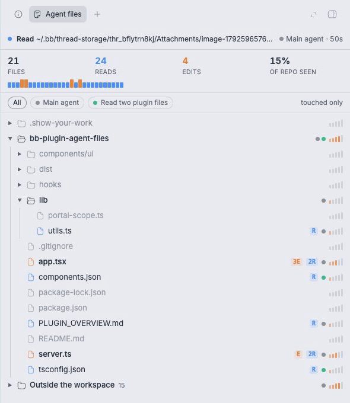

# Agent Files for bb

See which files your agents read, edit and search, live, as a tree beside the conversation.



Agent Files adds a tab to the right panel of every [bb](https://getbb.app) thread. It draws the thread's
working directory as a file tree and lights up each file as the agent, its subagents, and any child
threads touch it.

## Features

- **Live file tree.** The worktree as it is on disk (Git-ignore aware). Untouched files are dimmed.
  Folders open along the paths the agents touch.
- **What's happening now.** The file being read or edited glows, and a line at the top says what
  happened, to which file, and which agent did it.
- **Every agent, separately.** Subagent calls are attributed to the subagent that made them, and
  child threads are merged in. Each agent gets a colored dot; click one to see only its trail.
- **Heat and stats.** Read / edit / search counts per file, a heat meter on files and folders,
  totals, how much of the repo has been seen, and a strip of recent activity.
- **One click to the code.** Click a file to open it in bb's preview.

## Install

```sh
bb plugin install git:https://github.com/joaquincampo/bb-plugin-agent-files.git
```

Requires bb 0.46 or newer.

## Use

Open any thread and click the file icon in the thread header (or the right panel's **+** →
**Agent files**). The tab follows that thread. It keeps updating while the agent works.

| Control | What it does |
| --- | --- |
| Agent chips | Show only the files one agent or subagent touched |
| touched only | Hide files no agent has touched |
| Click a folder | Open or close it |
| Click a file | Open it in bb's preview |
| Hover a file | Full path, counts, agents, and when it was last touched |

## How it works

bb already records every tool call in the thread's event log, with file reads, edits and searches
normalized into `fileRead`, `fileChange` and `search` items. Subagent calls carry the id of the
`delegation` item that started them.

The plugin's server reads that log incrementally (only events after the last position it saw),
keeps a small per-thread index in the plugin's local storage, and sends a realtime signal so the
open panel refreshes. The tree comes from bb's workspace path listing. Nothing leaves your machine.

## Limits

- Files read through shell commands (`cat`, `grep` in a terminal tool) are not counted, since only
  the command text is recorded.
- Very fast calls finish before the panel's next update, so they show as "just touched" rather
  than in progress.
- On very large repos the tree lists the first 5,000 files, plus every file an agent touched.

## Development

```sh
npm install
bb plugin install .   # registers this folder in place
bb plugin dev         # rebuild and reload on every save
npm run typecheck
```

`server.ts` is the indexer and RPC; `app.tsx` is the panel and the header button.

## License

[MIT](LICENSE)
